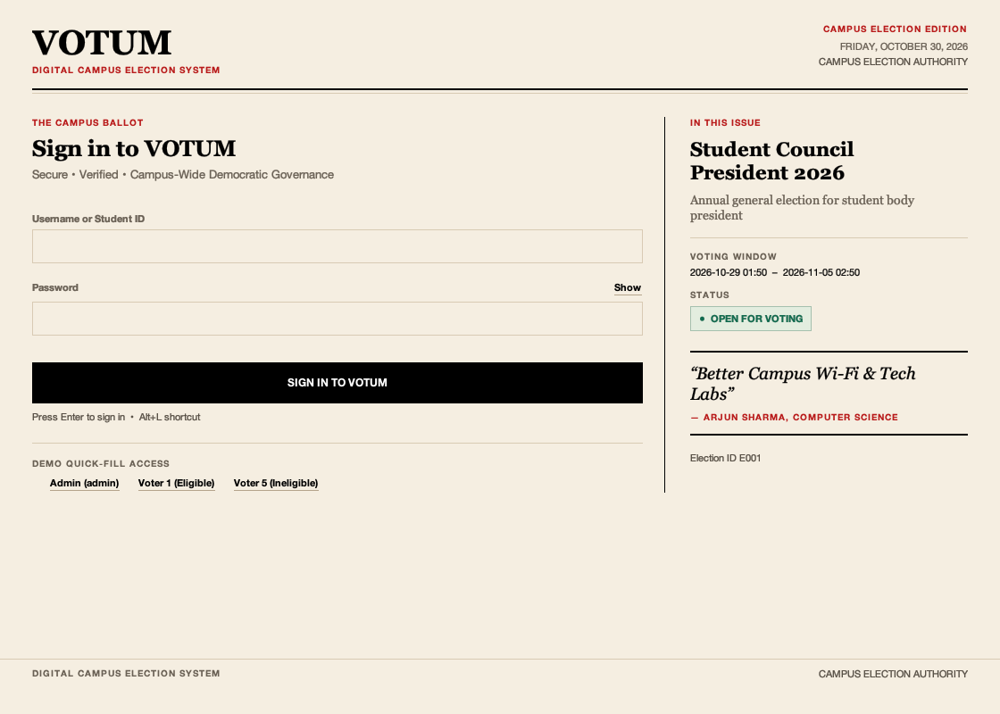
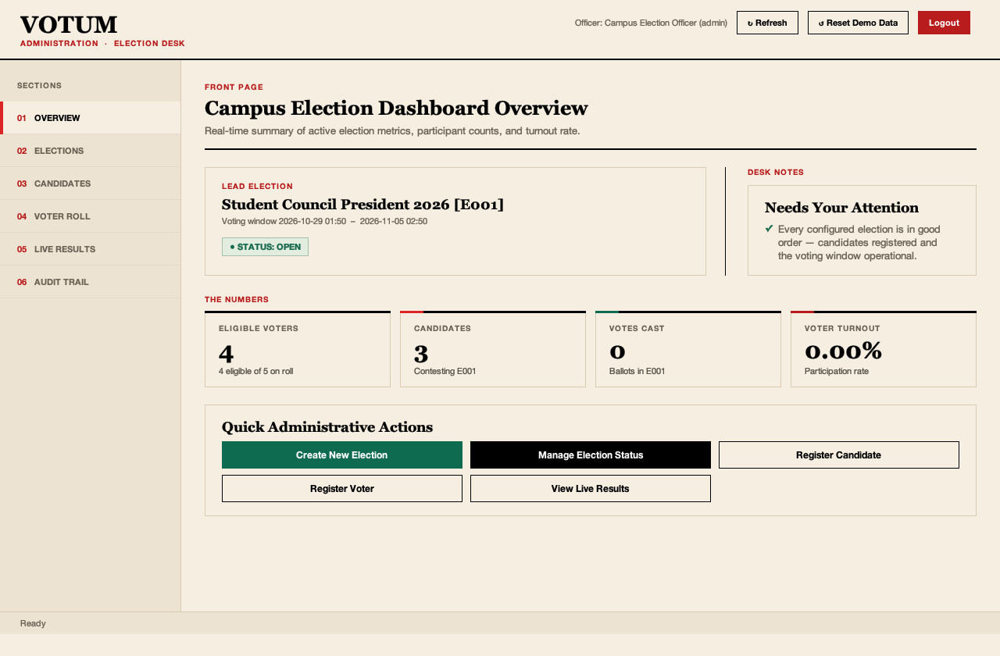
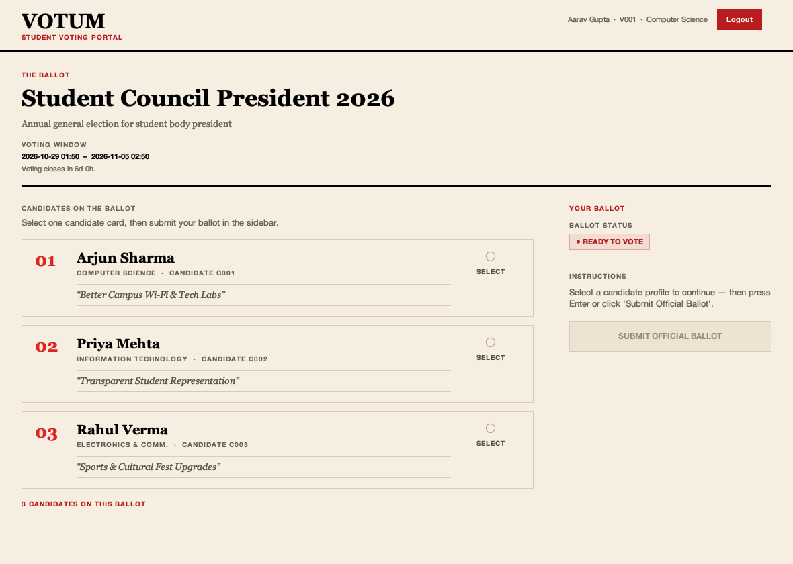
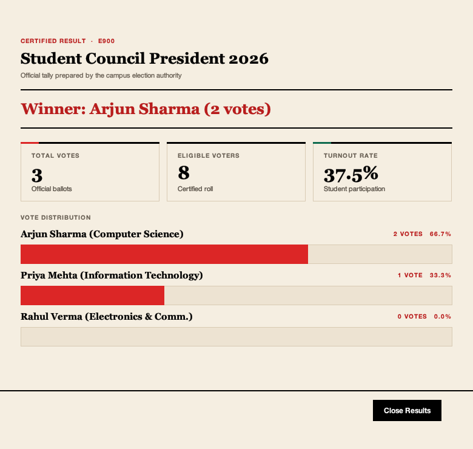

# VOTUM — Digital Campus Election Management System

> **A Simple, Reliable, Understandable, and Fully Functional Java Desktop Application**  
> *Developed for 2nd-Year B.Tech CSE OOP & Java Coursework*

---

## 1. Project Overview

**VOTUM** is a digital campus election management system designed to modernize and simplify college elections. It completely replaces the manual paper-ballot process:

```
[ Traditional Manual Process ]
Paper Ballot ➔ Collect Votes ➔ Manually Count ➔ Announce Result (Slow, Error-Prone)

[ VOTUM Digital Process ]
Admin Views Predefined Election ➔ Registers Candidates & Voters ➔ Opens Voting Window
➔ Voters Log In ➔ Cast Single Verified Ballot ➔ System Validates & Stores Vote
➔ Election Closes ➔ Instant Automatic Vote Counting ➔ Winner/Tie & Turnout Announced
```

---

## 2. Key Features

### Administrator Module
- **Secure Admin Authentication**: Login with dedicated administrative credentials.
- **Election Overview & Status Management**: View pre-configured election details, inspect voting window periods, and manage live election status (`OPEN` / `CLOSED`).
- **Election Creation**: Create additional campus elections from the admin panel — election ID (auto-suggested), title, description and a validated voting window (`yyyy-MM-dd HH:mm`) with quick-window presets. New elections are created as `DRAFT`, are automatically selected, and can be opened for voting in one click. Validation mirrors the service rules (required fields, `End` strictly after `Start`, duplicate IDs refused) and an all-past window is warned about.
- **Election Deletion & Clean-up**: Delete an election on click of `[ Delete Election ]`, automatically purging associated candidates, votes, resetting voter statuses, and logging the event in the audit trail.
- **Candidate Registration**: Register candidates with IDs, names, departments, slogans, and election associations.
- **Voter Roll Management**: Register students with voter IDs, login credentials, and eligibility flags.
- **Live Results & Metrics**: Instant calculation of total votes cast, eligible voter count, turnout percentage, candidate tallies, and automated tie detection.
- **Audit Trail Viewer & Management**: Inspect real-time timestamped audit logs for all events, auto-purge logs upon election deletion, and manually refresh/clear logs.

### Student Voter Module
- **Clean Voter Portal**: View active campus election details, descriptions, and voting windows.
- **Candidate Ballot**: Interactive single-selection candidate list with slogans and departments.
- **Confirmation Dialogue**: Clear verification prompt before final submission to avoid accidental votes.
- **Strict Single-Vote Enforcement**: Real-time status update to `ALREADY VOTED` and permanent blocking of duplicate ballots.
- **Voting Window Countdown**: The portal states how the clock relates to the window — *Voting opens in 4h 10m*, *Voting closes in 23h 40m*, or *The voting window ended 2h ago*.

- **Usability & Presentation**:
  - **Editorial Grid in warm beige**: a light beige paper canvas (`#F5EEE1`), black ink and one red accent; deeper beige for sidebars and table headers; serif display headlines; uppercase kickers; hairline column rules; numbered contents navigation; square status labels; and a printed colophon.
  - **Magazine composition**: asymmetric feature/sidebar grids on the front page and ballot, pull quotes and heavy section rules instead of rounded card chrome. The login keeps a **1120px readable measure** on wide screens, so extra width becomes symmetric beige margin rather than stretched fields.
  - **Motion with a reduced-motion switch**: screens fade and rise into view, metric values count up, vote bars grow into place and buttons invert on hover. Animations are disabled with `-Dvotum.motion=off`, `-Dvotum.reduceMotion=true`, or the platform reduced-motion setting.
  - **Accessible custom controls**: ink-and-red radio marks, check marks and combo chevrons; visible 2px focus rings; WCAG AA text contrast; accessible names for icon-only controls.
  - **Live dashboard metrics**: eligible voters, candidates, votes cast, and turnout are bound to live data via non-auditing preview tally.
  - **Scroll-safe desktop layout**: every content panel is wrapped in a paper-toned scroll pane with unit increments and a thin ink scrollbar.
  - **Editorial data tables**: uppercase header rules, hairline row dividers, zebra paper tint and high-contrast status badges (e.g. `ELIGIBLE` / `INELIGIBLE`, `VOTED` / `PENDING`).
  - **Actionable attention alerts**: real-time detection of unconfigured elections, expired open windows, or future start times with direct navigation.
  - **Keyboard-first accessibility**: initial focus in Username, `Enter` default button on all frames, `Alt+L` login shortcut, `Esc` result dialog dismissal, Caps Lock detection, and Show/Hide password toggles.

### Interface Preview

| Front page | Admin front page |
| :---: | :---: |
|  |  |
| **Student ballot** | **Certified results page** |
|  |  |

### Business Rules (Enforced in Service Layer)
1. **Rule 1**: Only registered and eligible voters can cast ballots.
2. **Rule 2**: A voter can vote only once per election (Duplicate votes strictly rejected).
3. **Rule 3**: Voting is permitted only when election status is `OPEN`.
4. **Rule 4**: Voting before election start time is rejected.
5. **Rule 5**: Voting after election end time is rejected.
6. **Rule 6**: Only valid candidates registered for the active election can be voted for.
7. **Rule 7**: Only administrators can configure elections and register participants.
8. **Rule 8**: Closed elections cannot accept any votes.

---

## 3. Technology Stack

- **Language**: Java (JDK 17 or newer)
- **GUI Framework**: Java Swing (`JFrame`, `JPanel`, `JTable`, `JTabbedPane`, `JRadioButton`, `JOptionPane`)
- **Date/Time API**: `java.time.LocalDateTime` & `DateTimeFormatter`
- **Data Collections**: `List`, `ArrayList`, `Map`, `LinkedHashMap`
- **Storage**: Plain-text delimiter files (`data/*.txt`) & Append-only Audit Log (`data/audit.log`)
- **Build/Run**: Zero external dependencies — runs directly with `javac` and `java` on any student laptop.

---

## 4. Default Demo Credentials

When the application runs for the first time, it automatically creates sample demo data in the `data/` directory:

| Role | Username | Password | ID / Name | Description |
| :--- | :--- | :--- | :--- | :--- |
| **Admin** | `admin` | `admin123` | `ADM001` - Election Officer | Full administrative privileges |
| **Voter 1** | `voter1` | `voter123` | `V001` - Aarav Gupta (CSE) | Eligible voter |
| **Voter 2** | `voter2` | `voter123` | `V002` - Ananya Singh (IT) | Eligible voter |
| **Voter 3** | `voter3` | `voter123` | `V003` - Rohan Nair (Mech) | Eligible voter |
| **Voter 4** | `voter4` | `voter123` | `V004` - Sneha Patel (ECE) | Eligible voter |
| **Voter 5** | `voter5` | `voter123` | `V005` - Dev Sharma (CSE) | Ineligible voter (for testing) |

> 💡 *Quick Fill Buttons are available on the login screen for rapid demonstration.*

---

## 5. How to Run the Project

### Option A: Using Provided Scripts (Recommended)

#### On macOS / Linux:
```bash
# Make scripts executable (if needed)
chmod +x run.sh test.sh compile.sh

# Run the Desktop Application
./run.sh

# Run the full 51-check Automated Test Suite
./test.sh
```

#### On Windows:
Double-click `run.bat` or open Command Prompt:
```cmd
run.bat
```

### Option B: Manual Command Line
```bash
# 1. Compile every Java source file into bin/ (explicit file list works in any shell)
javac -d bin $(find src -name "*.java")

# 2. Run the Main Application (always from the project root so data/ resolves)
java -cp bin com.votum.Main

# 3. Run the Automated Test Suite (24 checks)
java -cp bin com.votum.test.VotumTestSuite
```

> **Note:** `javac` accepts an explicit list of `.java` files, so the `**` glob above is
> expanded by `find`, not by the shell. On Windows the `.bat` scripts write the file list
> to `sources.txt` and use `javac @sources.txt` instead.

### Option C: In IntelliJ IDEA / Eclipse / Antigravity IDE
1. Open the project folder in your IDE.
2. Ensure Project SDK is set to **Java 17** or higher.
3. Locate `src/com/votum/Main.java`.
4. Right-click and choose **Run 'Main.main()'**.

---

## 6. Project Directory & Architecture

```text
JAVA Project/
├── .gitignore                             # Git ignore rules for build, binaries & OS artifacts
├── README.md                              # Main project overview, credentials & viva guide
├── MASTER.md                              # Detailed system specifications & architecture contracts
│
├── docs/                                  # Complete Coursework & Architecture Reports
│   ├── PROJECT_AUDIT.md                   # Complete architectural & defect audit
│   ├── ARCHITECTURE.md                    # 4-tier system architecture & data flows
│   ├── CSC2104_ALIGNMENT.md               # 12-topic syllabus compliance & viva guide
│   ├── FILE_FORMATS.md                    # Detailed flat-file storage layouts & schemas
│   ├── TESTING.md                         # Quality assurance handbook & manual test guide
│   ├── USER_GUIDE.md                      # Step-by-step user manual for Admins & Voters
│   ├── CHANGELOG.md                       # Chronological evolution & version history
│   └── IMPLEMENTATION_PLAN.md             # Multi-stage engineering roadmap
│
├── data/                                  # Plain-text persistence store
│   ├── README.md                          # Data schema, delimiters, and demo reset guide
│   ├── users.txt                          # Admin credentials & officer details
│   ├── voters.txt                         # Registered student voters & eligibility flags
│   ├── candidates.txt                     # Election candidates & slogans
│   ├── elections.txt                      # Campus elections, windows & statuses
│   ├── votes.txt                          # Immutable ballot records
│   └── audit.log                          # Append-only operational audit trail
│
├── scripts/                               # Cross-platform execution & test scripts
│   ├── compile.sh / compile.bat           # Strict compilation scripts (-Xlint:all)
│   ├── run.sh / run.bat                   # Desktop GUI launchers
│   └── test.sh / test.bat                 # 51-check automated test runners
│
├── compile.sh / compile.bat               # Root delegating build scripts
├── run.sh / run.bat                       # Root delegating launch scripts
├── test.sh / test.bat                     # Root delegating test runner scripts (51 checks)
│
├── src/                                   # Source code root
│   └── com/
│       └── votum/
│           ├── model/
│           │   ├── Identifiable.java          # Entity ID interface (CSC2104.3)
│           │   ├── AuthenticatableUser.java   # Authentication contract interface (CSC2104.3)
│           │   ├── User.java                  # Abstract base user with dynamic dispatch
│           │   ├── Admin.java                 # Admin subclass extending User
│           │   ├── Voter.java                 # Voter subclass extending User
│           │   ├── Candidate.java             # Candidate details & election link
│           │   ├── Election.java              # Election time-window & status model
│           │   ├── ElectionStatus.java        # Enum: DRAFT, OPEN, CLOSED
│           │   ├── Vote.java                  # Vote record with timestamp
│           │   └── ElectionResult.java        # Tally metrics & winner summary
│           │
│           ├── storage/
│           │   ├── FileManager.java           # Text file persistence & demo reset engine
│           │   └── AuditLogger.java           # Append-only text audit trail
│           │
│           ├── service/
│           │   ├── AuthenticationService.java # Auth logic for Admin & Voters
│           │   ├── ElectionService.java       # Election & candidate management, demo reset
│           │   ├── VotingService.java         # 8 election business rules enforcement
│           │   └── ResultService.java         # Votes aggregation, turnout %, tie detection
│           │
│           ├── exception/
│           │   ├── VotumException.java            # Base application exception
│           │   ├── InvalidLoginException.java     # Auth failure
│           │   ├── DuplicateVoteException.java    # Double-voting prevention
│           │   ├── ElectionClosedException.java   # Outside window / closed election
│           │   ├── InvalidCandidateException.java # Candidate mismatch
│           │   └── InvalidElectionException.java  # Creation validation failure
│           │
│           ├── ui/
│           │   ├── UITheme.java               # Editorial Grid design system: type, colour, controls, motion
│           │   ├── DateTimeInput.java         # Validated yyyy-MM-dd HH:mm input
│           │   ├── LoginFrame.java            # Authentication GUI with 3 quick-fills
│           │   ├── AdminDashboard.java        # Admin control center with live worker thread
│           │   ├── VoterDashboard.java        # Voter candidate ballot interface
│           │   └── ResultDialog.java          # Official election result dialog
│           │
│           ├── test/
│           │   ├── VotumTestSuite.java        # 24-point automated domain verification suite
│           │   └── UISmokeTestSuite.java      # 27-point automated UI & interaction smoke suite
│           │
│           └── Main.java                      # Application launcher & composition root
```

---

## 7. OOP Concepts Demonstrated (Viva Reference)

| OOP Concept | Project Implementation | Example File Link |
| :--- | :--- | :--- |
| **Interfaces** | Domain contracts `Identifiable` (getId) and `AuthenticatableUser` (auth & display) implemented across models. | [`Identifiable.java`](./src/com/votum/model/Identifiable.java), [`AuthenticatableUser.java`](./src/com/votum/model/AuthenticatableUser.java) |
| **Abstract Classes** | `User` is an `abstract class` defining `abstract String getDisplayName()` and `abstract String getId()`. | [`User.java`](./src/com/votum/model/User.java) |
| **Encapsulation** | All fields in model classes are `private`, accessed strictly via validated getters/setters. Defensive copies for unmodifiable maps/lists. | [`Election.java`](./src/com/votum/model/Election.java), [`ElectionResult.java`](./src/com/votum/model/ElectionResult.java) |
| **Inheritance** | `Admin` and `Voter` extend `User`, invoking `super(username, password, role)`. | [`Admin.java`](./src/com/votum/model/Admin.java), [`Voter.java`](./src/com/votum/model/Voter.java) |
| **Dynamic Dispatch & Polymorphism** | Calling `user.getDisplayName()` dynamically executes `Admin` or `Voter` implementation at runtime. | [`User.java`](./src/com/votum/model/User.java), [`AuthenticationService.java`](./src/com/votum/service/AuthenticationService.java) |
| **Multithreading** | Managed background daemon worker `LiveRefreshWorker` implementing `Runnable` with cooperative cancellation (`volatile boolean running`). | [`AdminDashboard.java`](./src/com/votum/ui/AdminDashboard.java) |
| **Enums** | `ElectionStatus` strongly types lifecycle state (`DRAFT`, `OPEN`, `CLOSED`). | [`ElectionStatus.java`](./src/com/votum/model/ElectionStatus.java) |
| **Custom Exceptions** | Hierarchy of domain checked exceptions inheriting from `VotumException`. | [`DuplicateVoteException.java`](./src/com/votum/exception/DuplicateVoteException.java) |
| **Separation of Concerns** | UI interacts only with Services; Services enforce rules and coordinate Storage; Storage manages plain text files. | [`VotingService.java`](./src/com/votum/service/VotingService.java) |

---

## 8. Verification & Test Suite

The project includes two automated test suites comprising **51 automated checks**:
1. [`VotumTestSuite.java`](./src/com/votum/test/VotumTestSuite.java) — **24-point domain and business-rule verification suite**:
   - `test1`–`test3`: Admin/voter authentication & invalid login rejection.
   - `test4`–`test6`: Election, candidate, and voter registration logic.
   - `test7`–`test9`: Ballot submission, duplicate detection, candidate validation.
   - `test10`–`test11`: Strict election window timing enforcement.
   - `test12`–`test14`: Vote counting, turnout calculation, tie detection.
   - `test15`–`test17`: Persistence reload, cascade election deletion, multi-election voting.
   - `test18`–`test20`: Admin username collision, corrupt record resilience, audit purge precision.
   - `test21`–`test24`: Window boundary precision, validation parity, full lifecycle, non-auditing preview tally.
2. [`UISmokeTestSuite.java`](./src/com/votum/test/UISmokeTestSuite.java) — **27-point UI, interaction, and academic contract smoke suite**:
   - Tokens, fonts, editorial button factories, 38px inputs, card panels, status badges.
   - Editorial table styling (36px rows), animated vote bars, date-time inputs.
   - Frame construction: `LoginFrame`, `AdminDashboard`, `VoterDashboard`, `ResultDialog`.
   - Default button bindings, minimum bounds, clean reload without exceptions.
   - `Identifiable` and `AuthenticatableUser` interface compliance checks.
   - Dynamic method dispatch verification on `getDisplayName()`.
   - Intentional demo reset verification restoring baseline active election and participants.

---

## 9. Team Member Contributions (4-Member Division)

- **Member 1 (Data Models & Core Logic)**:
  - Designed `User`, `Admin`, `Voter`, `Candidate`, `Election`, `Vote`, and `ElectionStatus` classes.
  - Implemented `ElectionService` lifecycle management.
- **Member 2 (Storage & Voting Rules)**:
  - Implemented `FileManager` for text-based file persistence and demo data auto-seeding.
  - Developed `VotingService` enforcing the 8 election business rules.
- **Member 3 (Swing GUI & User Experience)**:
  - Designed `UITheme`, `LoginFrame`, `AdminDashboard`, and `VoterDashboard`.
  - Built interactive candidate cards, real-time status badges, and confirmation dialogs.
- **Member 4 (Results, Audit Trail & QA Testing)**:
  - Developed `ResultService` and `ResultDialog` for vote tallying, turnout %, and tie detection.
  - Built `AuditLogger` and the 15-test automated verification suite (`VotumTestSuite`).

---

## 10. Data Integrity & Resilience Guarantees

These behaviours are verified by tests 17–21 and define how the plain-text store must behave:

1. **Delimiter safety** — `;`, CR and LF are stripped from free-text values on write, so a slogan such as `Win; Win` can never shift the remaining columns of a record.
2. **Fault-tolerant reads** — a malformed line (wrong column count, unparseable timestamp, unknown status) is skipped with a `stderr` warning; every healthy record after it still loads.
3. **Ballot before flag** — a vote record is written to `votes.txt` *before* the voter flag is updated, so a failed write can never lose the ballot while blocking the retry.
4. **Per-election single-vote rule** — duplicate detection is scoped to `(voter, election)` using the ballot records as the authoritative source, so voting in one election never blocks another.
5. **Token-scoped audit purge** — deleting an election removes only log entries that reference that election ID as a whole identifier.
6. **Time-window parity** — the voter portal enables the ballot only when the status is `OPEN` *and* the system clock is inside the configured start/end window.

---

## 11. Future Scope & Roadmap

- **Version 2 (Database Integration)**: Replace text files with SQLite / MySQL via JDBC.
- **Version 3 (Web/Mobile Interface)**: Add browser portal for remote campus voting.
- **Version 4 (College SSO / OTP Verification)**: Integrate college email OTP authentication.
- **Version 5 (Cryptographic Ballot Sealing)**: Implement SHA-256 hash chaining on vote records for enhanced tamper verification.
- **Version 6 (Multi-Department Elections)**: Support simultaneous elections restricted by department or semester.
